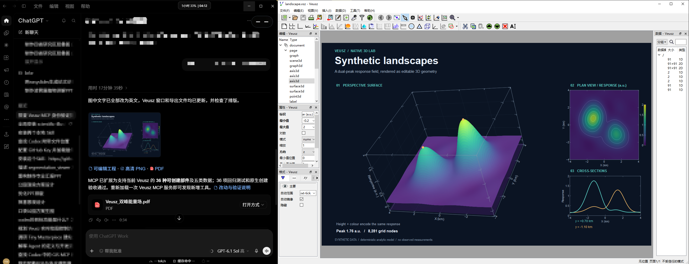

# Veusz MCP

让 AI 智能体操作 **Veusz 原生编辑器**：聊天中生成与调整科研图，Veusz 窗口同步显示；你也可以随时在界面中手工精修。

图形由 Veusz 的数据集、曲线、坐标轴、图例和文本对象组成，保存为可编辑的 `.vsz` 工程。绘图通过文档 API 完成，不依赖鼠标点击、屏幕坐标或整图截图替代。

> 当前为 v0.3（本地开发版），主要验证环境是 Windows 10、Veusz 4.2.1 和 Codex。不是 Veusz 官方项目。



上图展示 MCP 在 Veusz 原生编辑器中创建的可编辑三维合成地形；左侧为交互界面，右侧为 Veusz 完整编辑器。图中数据为合成示例。
## 可以做什么

- 导入数值 CSV/TSV，创建折线、散点和对称误差棒。
- 调整字体、字号、颜色、线宽、坐标范围、图例和标注。
- 在 Veusz 中实时查看结果，继续手工编辑。
- 保存 `.vsz`／`.vszh5` 原生工程，使用当前 Veusz 安装可用的全部原生导入和导出接口。
- 同一个 MCP 会话管理多个独立编辑窗口，每张图可单独查看、修改和保存。
- 读取用户最新修改，进行局部更新；版本冲突时拒绝覆盖。
- 查询不确定操作的结果，减少断线或重试导致的重复绘图。
- 按用户选择的绘图 Skill 应用格式规范，也可以完全不使用 Skill。

本项目没有内置大模型，也不调用额外模型 API。模型由你使用的 MCP 客户端提供。

## 工作方式

```text
MCP 客户端 / AI 智能体
        │ STDIO
        ▼
veusz_mcp.py
        │ 本机回环连接 + 会话令牌
        ▼
Veusz 插件 → Qt 主线程 → 原生文档与编辑窗口
```

MCP 服务使用独立 Python 环境；Veusz 使用它自己的 Python、Qt 和绘图环境。无需向 Veusz 自带的 Python 中安装 MCP SDK。

## 环境要求

| 项目 | 要求或已验证范围 |
|---|---|
| 操作系统 | 当前启动与窗口校验实现针对 Windows；macOS、Linux 尚未支持此启动流程 |
| Veusz | 建议 4.2.1；4.2.1 已完成中文界面实际窗口验证 |
| MCP 服务 Python | 3.11 或更高，推荐 3.12；本地主要测试版本为 3.12 |
| MCP SDK | `mcp==1.30.0` |
| 客户端 | 支持本地 STDIO MCP；实际验证过 Codex |
| 桌面 | 已登录、可交互的真实 Windows 桌面 |

Veusz 请从[官方网站](https://veusz.github.io/)安装。本仓库不分发 Veusz 或 Qt 安装包。

## 快速开始

以下命令在 **PowerShell** 中分别执行。先克隆或下载本仓库，然后进入项目目录：

```powershell
git clone https://github.com/wangyq001/veusz-mcp.git
cd .\veusz-mcp
```

### 1. 创建项目环境

```powershell
powershell -NoProfile -ExecutionPolicy Bypass -File .\setup.ps1
```

脚本会寻找 Python，创建项目内的 `.venv`，安装依赖并运行不需要 Veusz GUI 的自动测试。如果 Python 不在 PATH 中，可显式指定：

```powershell
powershell -NoProfile -ExecutionPolicy Bypass -File .\setup.ps1 -Python "C:\Python312\python.exe"
```

默认安装 [requirements.txt](requirements.txt)。需要复现维护者依赖快照时使用 `-Locked`；[requirements-lock.txt](requirements-lock.txt) 来自维护者 Windows 环境，不代表所有 Python 版本都已验证。

已存在的项目环境会被复用；脚本不会删除它，也不修改 Veusz 的 Python 环境。

### 2. 配置 Veusz 可执行文件

推荐使用本地配置：

```powershell
Copy-Item .\examples\veusz.local.example.json .\veusz.local.json
notepad .\veusz.local.json
```

把路径改为自己的安装位置，例如：

```json
{
  "executable": "C:/Program Files/Veusz/veusz.exe"
}
```

`veusz.local.json` 已被 Git 忽略。也可在当前 PowerShell 中设置：

```powershell
$env:VEUSZ_EXE = "C:\Program Files\Veusz\veusz.exe"
```

首次启动的查找顺序为：`--exe` 参数 → `VEUSZ_EXE` → `veusz.local.json` → PATH → 常见 Windows 安装目录。显式配置的路径无效时会报错，不会偷偷换用其他安装。

### 3. 启动可见编辑器

在用户桌面双击 `start_veusz.cmd`，或运行：

```powershell
.\start_veusz.cmd
```

也支持单次指定：

```powershell
.\start_veusz.cmd --exe "C:\Program Files\Veusz\veusz.exe"
```

先处理 Veusz 的首次运行提示，再让智能体连接。已连接的受控窗口会被复用；不会自动接管用户另行打开、尚未加载本插件的窗口。

**智能体不能从隔离桌面直接启动 GUI。** 例如 Codex 的沙箱桌面与用户实际看到的桌面可能不同，即使进程存在、Qt 返回“可见”，用户仍看不到窗口。本项目会检查启动线程和 Veusz 是否位于当前输入桌面，并核验原生窗口所属进程、可见状态、最小化状态及屏幕位置。隔离桌面启动会在创建 GUI 前拒绝；客户端应使用获准的桌面执行方式，或由用户手动启动脚本。不会绕过系统权限。

启动器会请求恢复和前台激活。Windows 可能拒绝自动切换前台，此时可从任务栏选择已打开的 Veusz 窗口。

### 4. 配置 MCP 客户端

**Codex CLI 已安装时**，可自动注册：

```powershell
powershell -NoProfile -ExecutionPolicy Bypass -File .\configure_codex.ps1
```

重新加载 MCP 服务即可；不需要关闭 Veusz。脚本发现同名但指向其他项目的 MCP 时会拒绝覆盖。

其他支持本地 STDIO MCP 的客户端可参考以下 JSON，把路径换成自己的项目位置：

```json
{
  "mcpServers": {
    "veusz": {
      "command": "D:/tools/veusz-mcp/.venv/Scripts/python.exe",
      "args": ["D:/tools/veusz-mcp/veusz_mcp.py"],
      "env": {
        "PYTHONIOENCODING": "utf-8"
      }
    }
  }
}
```

也可使用 [start_mcp.cmd](start_mcp.cmd) 作为 STDIO 入口。不同客户端的配置位置和字段包装可能不同，请遵循各自文档。支持本地 MCP 是接入前提，并不代表本项目已经逐一验收 Claude Code、Cursor、Trae 或其他客户端；纯网页聊天产品通常不能直接启动本机 Python。

### 5. 开始绘图

可直接向智能体说：

> 连接 Veusz，先检查当前窗口和文档状态。用 examples/simulated_robustness.csv 绘制三条均值曲线，以对应的 sd 列绘制标准差误差棒。使用 Times New Roman，去掉网格线，保留原生可编辑对象，并保存工程。

手工修改后继续说：

> 读取我刚才在界面中修改的图例。保留这些修改，只把 proposed 曲线改为深蓝色、线宽改为 2.5pt，再导出 PDF。

文件导入、保存与覆盖由客户端按任务授权执行。请明确数据路径、数值含义、单位和输出位置。

## 与绘图 Skill 配合

Skill 是**可选的设计指导**，不绑定任何特定 Skill，也不是 MCP 内置绘图后端。

在客户端选择一个绘图 Skill 后，可以说：

> 按所选 Skill 的字体、配色、字号和排版规范绘图，最终使用 Veusz 原生对象，并在当前窗口显示。允许用代码计算数据。

智能体应读取 Skill 中适用的设计指导，再将其转换成 Veusz 属性；用户明确要求优先于 Skill 默认值。已有手工修改应按本次任务范围保留。

- 未选择 Skill 时，正常绘图，不需要额外组合提示。
- 选择和读取 Skill 由客户端智能体负责，MCP 不扫描或安装 Skill。
- 允许代码生成模拟数据或计算统计量；最终绘图由 Veusz 完成。
- 不把 Matplotlib 等后端生成的整张图片嵌入 Veusz 来冒充原生图。
- 不是“任意绘图脚本自动转 Veusz”的转换器；不支持的效果应明确说明。
- 不分发第三方 Skill，使用时请自行安装并遵守其许可证。

## 全类型原生图表支持

MCP 从运行中的 Veusz 部件工厂动态发现类型，不维护二维部件白名单。覆盖范围是当前安装版本及已注册插件实际提供的图形；Veusz 自身不支持的效果不在此范围内。

推荐流程：

1. `veusz_status` 检查文档、窗口和版本。
2. `veusz_widget_catalog` 查询全部类型与父部件要求；指定 `widget_type` 获取递归参数、默认值、可选项和数据维度。父类名可能是 `generic`；指定 `parent_path` 可判断实际父对象是否合法。
3. `veusz_set_data` 写入 `1d`、`2d`、`nd`、`text`、`datetime` 数据。二维矩阵按行存储，x 对应列、y 对应行；数值 `null` 表示缺测。日期使用 ISO 8601，带时区的输入转换为 UTC。
4. `veusz_add_widgets` 创建已注册部件，包括三维场景、三维曲面／点线／体数据、等高线、图像、柱形、极坐标、三元图、矢量场、形状和标注等。实际类型以目录为准。`autoadd=false` 关闭默认子部件，新父部件须在批次中排在子部件前。
5. `veusz_inspect` 查看当前参数和已注册动作；`veusz_apply_changes` 调整原生参数，`veusz_widget_action` 执行拟合等已注册原生动作。
6. 原生保存、PNG／SVG／PDF 导出及预览继续使用原接口。

数据和部件批次保留单步撤销、冲突检查、失败回滚和手动编辑保护。已有数据须显式 `replace=true`。第三方插件的外部依赖、有效数据条件和 Veusz 自身限制仍然适用；接口覆盖全部注册类型，不代表所有参数组合均已验收。

更新代码后，重新加载 MCP 服务以发现新增工具；已启动的 Veusz 插件需在保存工作后由用户重新启动，智能体不会自动关闭现有窗口。

原生验收：在已连接且无模态提示框的 Veusz 上执行 `python tests/acceptance_native.py`。该脚本通过真实 MCP 测试全部可创建类型的参数发现、创建与撤销，以及五类数据、失败回滚和版本冲突；临时测试内容会撤销。

## 多窗口：每张独立图保留自己的编辑器

新的独立图默认应先调用 `veusz_new_window`，而不是把所有图反复画到原来的页面。用户明确要求子图或多页工程时才复用同一文档。

1. `veusz_new_window(name="Figure A", request_id="unique-launch-id")` 创建独立 Veusz 进程和窗口，返回稳定的 `window_id`。启动结果不确定时复用同一 `request_id`，避免重复开窗。
2. `veusz_windows` 列出窗口、连接状态、文档和可见性，不返回令牌。窗口关闭后会标记为不可用，不会把操作转发给其他窗口。
3. 对目标窗口调用 `veusz_status(window_id=...)`，再给读写工具同时传入 `window_id`、`document_id`、`revision`。各窗口保留独立数据、修改状态和撤销历史。
4. `veusz_arrange_windows(window_ids=[...], columns=2)` 可排列指定窗口并适合页面；`veusz_window_view` 可单独切换页码、恢复窗口和适合页面。
5. 多窗口情况下，未明确目标的读取会报告 `AMBIGUOUS_WINDOW`。旧调用中的写入仍可按唯一文档标识路由，但推荐始终显式给出 `window_id`，避免等待其他窗口。

也可直接从真实桌面运行：

```powershell
.\start_veusz.cmd --new-window --name "Figure A"
.\start_veusz.cmd --new-window --name "Figure B"
```

启动脚本会启动一个独立的本机桌面宿主。它只接收带令牌的本机启动请求，使 Veusz 不会被 MCP 客户端在重连时连带清理。宿主不注册系统服务或登录启动项；未运行时可从真实桌面执行 `start_veusz.cmd --start-host`。不能从隔离桌面偷偷启动宿主。

桌面宿主与各 Veusz 窗口独立于 MCP 服务。重连 MCP 不会关闭图；重启电脑或注销后，仍需重新启动脚本并打开已保存工程。不要删除运行中窗口的会话文件。

## 文件格式：以当前安装能力为准

- 先调用 `veusz_file_formats(window_id=...)`，查询原生导出格式、工程支持、文件导入命令的必填参数及已安装导入插件。
- `veusz_import_file` 只调用 Veusz 注册的文件导入器，不开放任意 Python 或任意方法执行。支持原生文本、CSV、二维／多维文本、HDF5、FITS，以及插件提供的 NPY、NPZ、QDP、二进制、VO 表等格式；实际清单由目标安装决定。
- `veusz_export` 按原生目录验证格式，支持 `quality`、`color`、`antialias`、`pdfdpi`、`svgdpi`、`svgtextastext` 等选项。用 `pages=[0,1]` 导出多页 PDF／PS；其他格式仍限一页。
- 导出先生成临时文件，确认非空后再原子替换目标；失败不会用空文件覆盖已有输出。格式内容和布局仍应单独检查。
- `.vszh5` 保存会做原生重开预检。针对 Veusz 4.2.1 的 HDF5 加载器无法读回 ND 数据的问题，多维数组使用工程中的原生 `SetDataND` 文本命令编码，仍可由未安装本 MCP 的 Veusz 打开。
- EPS／PS 依赖 Ghostscript，HDF5 依赖 h5py，FITS／VO 表依赖相应天文数据模块。缺少依赖时明确报告不可用。

本轮本地验收通过：14 个导入用例、BMP／EMF／JPG／JPEG／PDF／PNG／SVG／TIFF／WebP／XPM 导出、两页 PDF，以及 `.vsz`／`.vszh5` 往返。当前机器缺少可用 Ghostscript，所以 EPS／PS 未声称通过。第三方插件或复杂参数组合不等于已经全部验收。

升级时须重新连接一次 MCP，加载新增工具和 `window_id` 参数。旧窗口可以保留；新接口应在随后新建的窗口中使用。旧插件不支持的方法需保存工作后由用户重启该窗口，智能体不会丢弃未保存图形。

新增真实验收脚本：`tests/acceptance_formats.py` 需要通过 `VEUSZ_SESSION_FILE` 指定独立空白测试窗口；`tests/acceptance_windows.py` 创建三张测试图，验证独立编辑、排列和 MCP 重连，并保留窗口用于查看。它们不是日常绘图入口，不应运行在重要工作文档上。

## 工具一览

| 工具 | 用途 |
|---|---|
| `veusz_status` | 连接、文档版本、桌面身份、数据、对象树、弹窗和渲染状态 |
| `veusz_windows` | 列出独立窗口及稳定的窗口标识 |
| `veusz_new_window` | 创建独立原生编辑窗口，保留已有图 |
| `veusz_arrange_windows` | 排列指定的多个窗口并适合页面 |
| `veusz_window_view` | 恢复一个窗口、切换页面、调整显示范围 |
| `veusz_file_formats` | 查询安装实例的格式、依赖和导入参数 |
| `veusz_import_file` | 调用已注册的原生文件导入器及格式插件 |
| `veusz_inspect` | 查询有效属性路径、设置分组和当前值 |
| `veusz_widget_catalog` | 动态查询全部已注册部件、父对象要求及递归参数定义 |
| `veusz_set_data` | 写入一维、二维、多维、文本和日期数据 |
| `veusz_widget_action` | 执行图形已注册的原生动作，例如拟合 |
| `veusz_import_data` | 导入数值 CSV/TSV，并记录字段、行数和来源哈希 |
| `veusz_plot` | 创建折线、散点和对称误差棒 |
| `veusz_add_widgets` | 添加任意已注册的原生二维／三维部件 |
| `veusz_apply_changes` | 验证后的局部属性修改 |
| `veusz_undo` | 撤销最近且未被后续编辑改变的桥接操作 |
| `veusz_save` | 保存可编辑 `.vsz`／`.vszh5` 和数据来源清单 |
| `veusz_checkpoint` | 保存恢复点，保留当前工作文件名和编辑状态 |
| `veusz_open` | 经过预检打开工程，拒绝丢弃未保存修改 |
| `veusz_preview` | 返回带文档版本的 PNG 预览 |
| `veusz_export` | 使用原生可用格式导出；支持多页 PDF／PS |
| `veusz_operation` | 查询已提交写请求的状态与结果 |

工具使用约定：

1. 修改前先读目标窗口状态，显式携带 `window_id`、`document_id` 和 `revision`。
2. 发生 `REVISION_CONFLICT` 时读取用户最新修改，重新判断局部改动；不能只更新版本号后盲目重放。
3. 操作结果不确定时查询原 `request_id`，不要直接重复写入。
4. 预览是渲染结果，不等于用户已看到窗口；桌面身份及真实显示应分别核验。

## 数据与安全边界

- CSV/TSV 需要唯一列名和数值列。默认拒绝缺失、非数值及非有限值；`missing=drop_rows` 会对所有选中列同步删除不完整的整行。
- 严格数值 CSV/TSV 工具的输入上限为 50 MiB、100 万行、200 万个选中数值。原生文件导入按对应导入器规则读取，不要求把大型文件内容放入 JSON 请求。
- 覆盖数据集须显式 `replace=true`；对数坐标要求正数。
- 页码从 0 开始，导出默认使用当前页，DPI 范围为 50–1200。
- 输出工程、预览、导出与恢复点限定在项目目录中；数值输入可来自用户指定的本地文件。
- 桥接仅监听 `127.0.0.1`，使用随机会话令牌；不提供通用任意 Python 执行工具。
- Veusz 文档操作在 Qt 主线程执行；每个受控进程管理一个窗口，MCP 同时路由多个这样的进程。
- MCP 断开不会关闭 Veusz；不会自动强制结束用户进程。
- 用户在界面中的编辑会更新版本，但不会在聊天空闲时自动唤醒模型。
- 保存的 `.vsz.json`／`.vszh5.json` 记录数据来源；恢复点按需创建，目前没有定时自动保存。
- 撤销和补偿覆盖本版验证过的设置、数据和对象添加，不承诺任意第三方插件操作具有完整事务性。

`runtime/` 中包含私密会话令牌和操作记录，**不要上传或分享**。本地 `output/`、虚拟环境、安装路径配置和编译翻译文件均默认被 Git 忽略。

## 诊断与测试

只读诊断，不启动或关闭窗口：

```powershell
.\.venv\Scripts\python.exe .\diagnose.py
```

多窗口时，该命令先列出窗口清单；可用 `diagnose.py --window-id <窗口标识>` 检查其中一个，不会因为旧默认窗口已关闭而把其他窗口误报为断线。

诊断会分别显示当前命令所在桌面与已连接 Veusz 所在桌面。命令在沙箱中运行、Veusz 在真实桌面中运行，是可能且正常的组合；判断窗口应查看连接本身的 `desktop_is_interactive`。

常见问题：

| 现象 | 检查方式 |
|---|---|
| 找不到 Python | 给 `setup.ps1` 传入 `-Python`，避开未安装 Python 的商店占位程序 |
| 找不到 Veusz | 配置 `veusz.local.json`、`VEUSZ_EXE` 或 `--exe` |
| 连接被拒绝 | 在真实桌面运行启动脚本，处理首次运行提示，再读状态 |
| 有进程却看不到窗口 | 检查 `thread_desktop` 与 `input_desktop`；不能把隔离桌面当成真实桌面 |
| 弹窗期间无法修改 | 先处理 Veusz 提示，不应盲目重试 |
| 版本冲突 | 读回最新设置，保留用户编辑后重新制定局部修改 |
| 图在另一个页面 | 检查 `page`；导出时指定正确的从 0 开始页码 |
| STDIO 测试出现目录或管道权限错误 | 在普通用户 PowerShell 中运行，检查沙箱权限；不要因此更换为无界面 GUI 验收 |

自动测试不需要安装或启动 Veusz：

```powershell
.\.venv\Scripts\python.exe -m unittest discover -s tests -v
```

测试覆盖数据校验、路径配置优先级、可见桌面约束、版本和请求协议、鉴权、超时、去重及 Skill 指导的 MCP 传递。GUI 插件的语法检查：

```powershell
.\.venv\Scripts\python.exe -m py_compile veusz_bridge/plugin.py
```

实际 GUI 验收脚本为 `tests/acceptance_v1.py`、`tests/manual_v1.py`。这些是开发测试，不是快速开始入口：应使用独立测试窗口和 `VEUSZ_SESSION_FILE`，不能对重要工作文档直接执行。自动验收默认读取所配置 Veusz 安装目录中的 `examples/example_csv.csv`，也可用 `VEUSZ_EXAMPLE_CSV` 显式指定上游示例 CSV。

窗口实测与单元测试是两类证据。本项目已在真实 Windows 桌面中验证 Veusz 4.2.1 的绘图、手工修改读回、保存、导出和桌面显示；不以无界面运行或导出成功替代真实窗口验收。

## 项目结构

```text
veusz_mcp.py          MCP STDIO 服务与类型化工具
bridge_cli.py         可见窗口启动器和桥接命令入口
plugin_entry.py      Veusz 插件加载入口
veusz_bridge/        主线程适配、协议、数据导入和桌面身份校验
setup.ps1            项目环境安装
configure_codex.ps1  可选的 Codex 自动注册
start_veusz.cmd      启动或复用原生编辑窗口
start_mcp.cmd        STDIO 服务入口
diagnose.py          只读连接和桌面诊断
examples/            路径配置与模拟数据
tests/               自动测试和开发验收脚本
```

## 中文界面

Veusz 支持加载 Qt 翻译文件。可使用[官方翻译源码](https://github.com/veusz/veusz/tree/master/translation)或上游推荐的翻译途径；设置中的 Translation 通常需要编译后的 `.qm` 文件，而不是 `.ts` 源文件。翻译完整度与所用版本有关。

本项目支持连接已汉化的 Veusz，不依赖菜单显示语言。仓库不附带维护者本地编译的翻译二进制，避免版本混淆；使用或再分发上游翻译时应保留其许可与署名。

## 许可证与致谢

本项目原创代码按 **GNU GPL v2 或任意更高版本（GPL-2.0-or-later）** 分发。许可证正文见 [LICENSE](LICENSE)，第三方来源说明见 [THIRD_PARTY_NOTICES.md](THIRD_PARTY_NOTICES.md)。

感谢 [Veusz](https://github.com/veusz/veusz) 提供原生可编辑科学绘图环境，以及 [MCP Python SDK](https://github.com/modelcontextprotocol/python-sdk) 提供通信框架。

欢迎提交问题或贡献。报告故障时请提供 Veusz、Python、Windows 版本及已脱敏的诊断结果，不要附带会话令牌、私人实验数据或完整 `runtime/` 目录。
